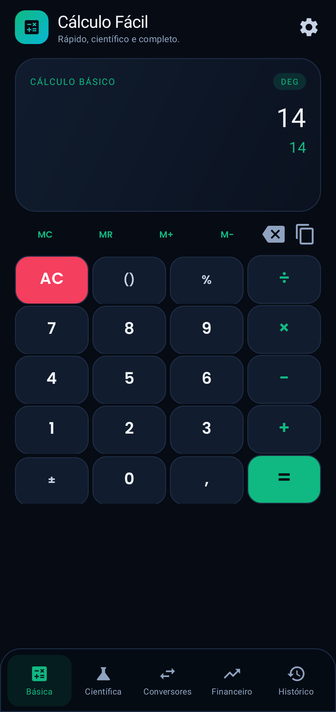
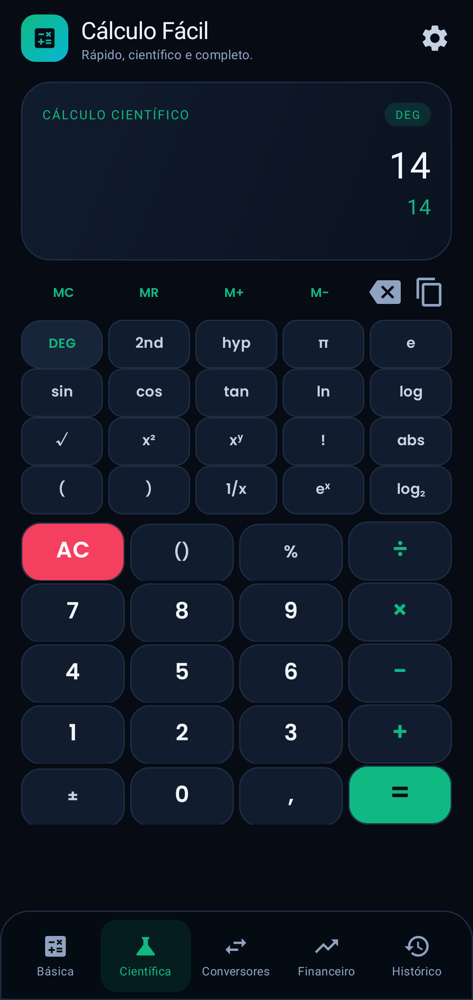
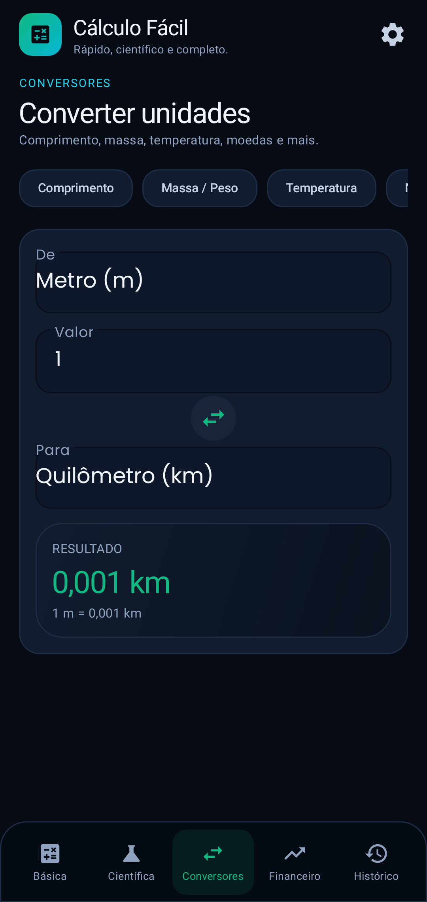
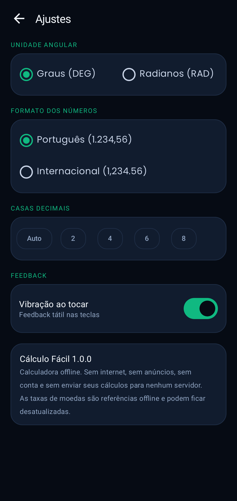

# Cálculo Fácil — Android nativo

[](https://github.com/aldecirv/calculo-facil-android/releases/latest)
[](https://github.com/aldecirv/calculo-facil-android/actions/workflows/build.yml)

**Calculadora rápida e completa para o dia a dia: científica, conversores, finanças e histórico.**

Aplicativo Android nativo em **Kotlin + XML + Material 3**, feito a partir do web app **Cálculo Fácil** (React/Vite). Funciona **offline**, sem conta, sem anúncios e sem telemetria.



## Recursos

- **Básica**: operações, parênteses inteligentes, porcentagem, fatorial, sinal, memória (MC/MR/M+/M−), cópia do resultado e histórico.
- **Científica**: seno, cosseno, tangente, inversas, hiperbólicas, logaritmos, raiz, potência, π, e, 2nd/hyp, graus ou radianos.
- **Conversores**: comprimento, massa, temperatura, moedas, área, volume, velocidade, tempo e dados digitais.
- **Financeiro**: desconto, porcentagem, regra de 3, gorjeta/conta, juros compostos e financiamento PRICE/SAC.
- **Histórico**: cálculos salvos localmente, reutilização com um toque e limpeza.
- **Ajustes**: DEG/RAD, formato pt-BR/internacional, casas decimais e vibração.

| Científica | Conversores | Financeiro |
|---|---|---|
|  |  |  |

| Histórico | Ajustes |
|---|---|
|  |  |

## Privacidade e honestidade

- **Sem permissão de internet** e sem SDK de anúncios/analytics.
- Cálculos, histórico e ajustes ficam no aparelho (`SharedPreferences`).
- **Moedas**: taxas de referência **offline**; não são cotações ao vivo. O app avisa isso na tela.
- O parser e as fórmulas são implementados localmente. Erros matemáticos aparecem como erros explícitos, não como números inventados.
- Não há integração com Gemini/nuvem nesta versão, apesar da capacidade declarada no `metadata.json` do material original.
- O tema é escuro fixo nesta 1.0.0; o web app tinha opções claro/escuro/automático.
- O feedback sonoro do original foi substituído por vibração opcional.

## Arquitetura

```
app/src/main/java/com/calculofacil/app/
├── data/
│   ├── MathEngine.kt        parser recursivo (funções, ângulo, fatorial, %)
│   ├── CalcSession.kt       estado da calculadora e memória
│   ├── CalcStore.kt         histórico/ajustes/memória persistidos
│   ├── Units.kt             unidades e moedas de referência
│   └── Models.kt            formatação pt-BR/en-US
├── ui/
│   ├── MainActivity.kt      navegação por 5 abas
│   ├── SettingsActivity.kt
│   ├── fragments/           Calculator, Converters, Finance, History
│   └── adapters/            HistoryAdapter
└── util/ThemeUtils.kt
```

- Kotlin, `minSdk 24`, `targetSdk 35`, ViewBinding, Material 3.
- Sem Room/Hilt: persistência simples e APK enxuto.
- Fonte Poppins (SIL OFL).

## Build

```bash
export JAVA_HOME=/caminho/para/jdk-17
gradle :app:assembleDebug
```

Release assinado:

```bash
export AURORA_KEYSTORE_PATH=/caminho/aurora.jks
export AURORA_KEYSTORE_PASS=...
export AURORA_KEY_ALIAS=aurora
export AURORA_KEY_PASS=...
gradle :app:assembleRelease
```

CI: `.github/workflows/build.yml` usa os secrets `AURORA_*`.

Testes:

```bash
gradle :app:testDebugUnitTest
```

Cobrem precedência e funções do parser, erros matemáticos, formatação/parse, persistência do histórico/memória, fluxo de um cálculo financeiro e screenshots Robolectric das telas.

## Limitações

- Conversão de moedas usa taxas estáticas de referência, não cotações em tempo real.
- Tema claro/automático e efeitos sonoros do web app não foram portados.
- Entrada por teclado físico não foi implementada.
- Validação por testes e screenshots Robolectric; recomenda-se testar em aparelho físico.

## Versão

**1.0.0** — primeira versão Android nativa do Cálculo Fácil, com calculadora básica/científica, conversores, finanças, histórico e ajustes offline.

APK: [**calculo-facil-1.0.0.apk**](https://github.com/aldecirv/calculo-facil-android/releases/download/v1.0.0/calculo-facil-1.0.0.apk) · [Release v1.0.0](https://github.com/aldecirv/calculo-facil-android/releases/tag/v1.0.0)
